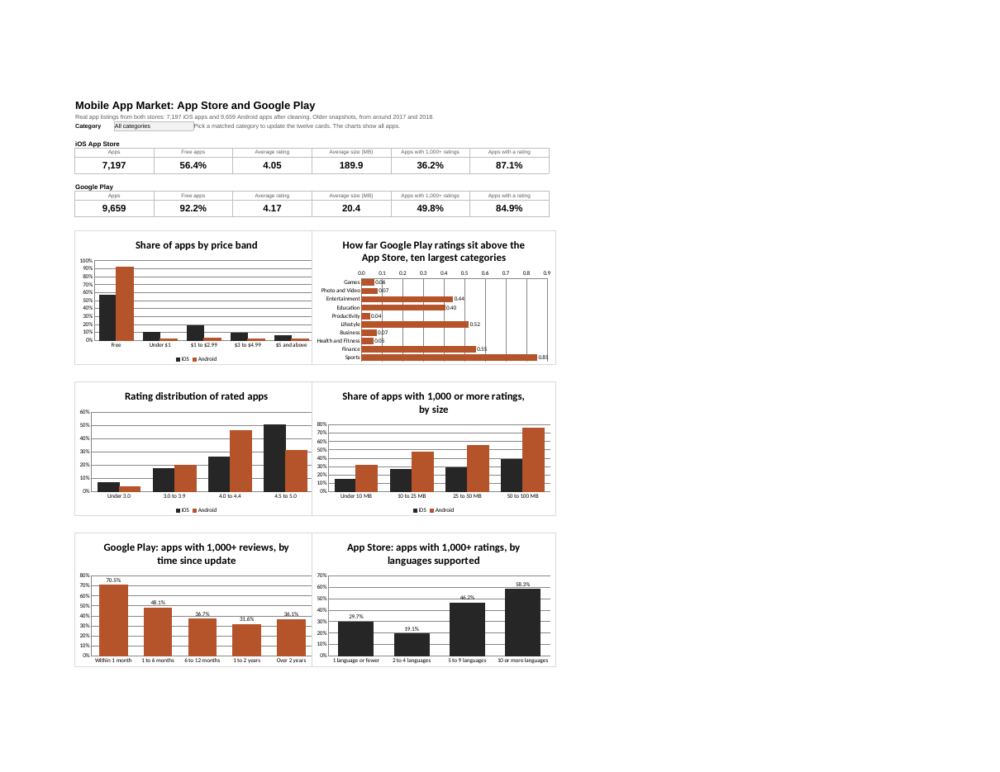
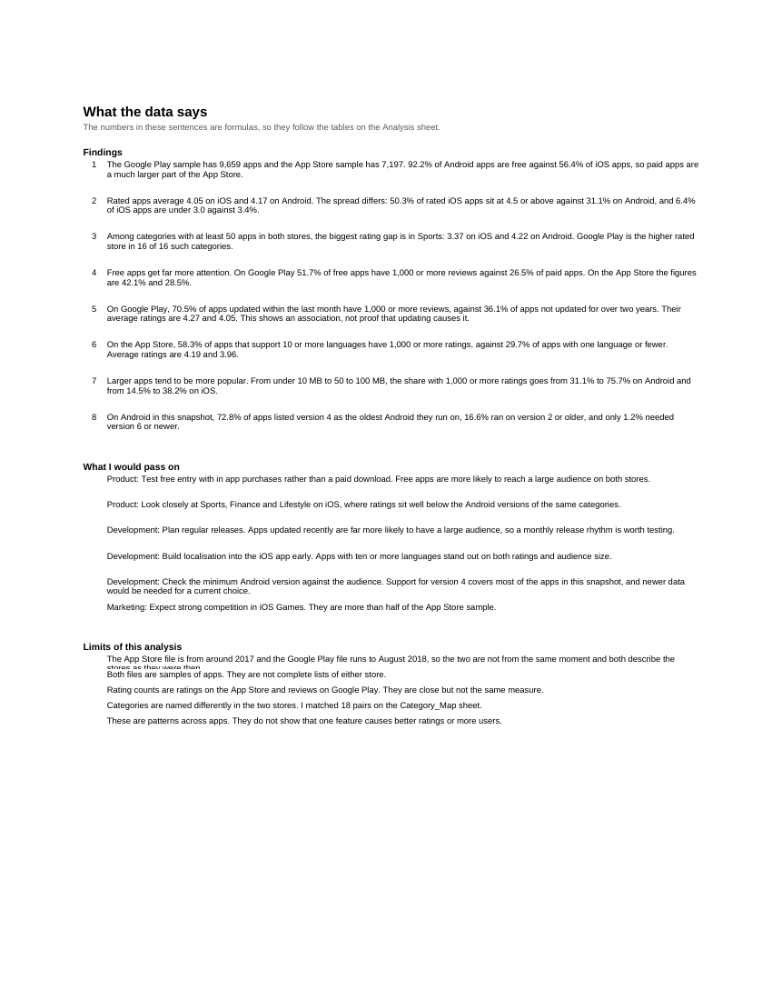
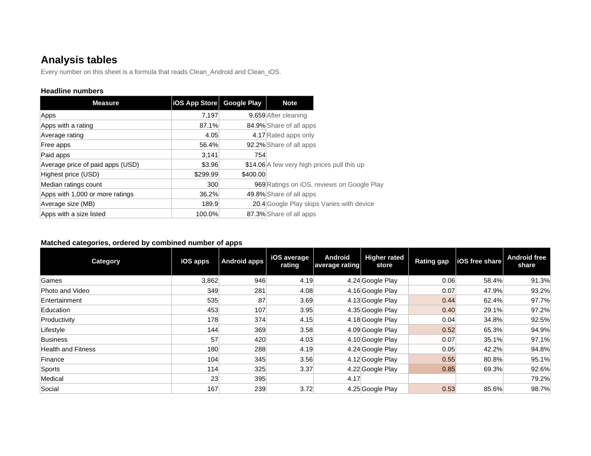
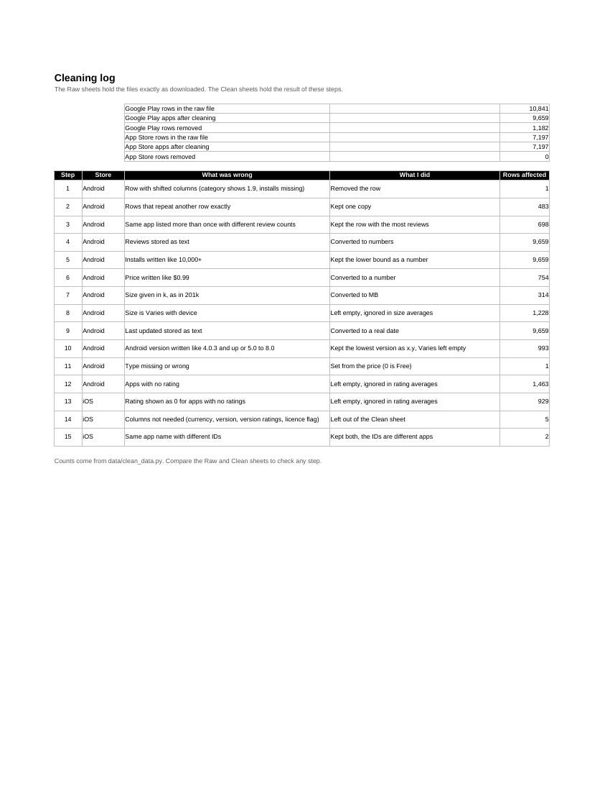

# Mobile App Market Analysis in Excel

An Excel analysis of two real app store datasets, Google Play and the Apple App Store: cleaning, formula driven tables, a dashboard, written findings and a category match between the two stores.



## Objective

Compare how apps look on iOS and Android, and find the patterns a product or development team could act on: pricing, ratings, popularity, update habits, language support, app size and Android version support.

## Data

Two public datasets of real app listings, both shared on Kaggle.

* [Google Play Store Apps](https://www.kaggle.com/datasets/lava18/google-play-store-apps), shared by Lavanya Gupta. 10,841 rows, 9,659 apps after cleaning. The latest update date in the file is 8 August 2018.
* [Apple App Store apps](https://www.kaggle.com/datasets/ramamet4/app-store-apple-data-set-10k-apps), shared by ramamet4. 7,197 apps, from around 2017.

The files in `data/` are the CSVs exactly as downloaded, from a [public GitHub copy](https://github.com/AvinashBolleddula/Profitable-App-Profiles). Check the Kaggle pages for collection details and licence terms before reusing them. See `data/README.md` for notes.

## Business questions

1. How do the two stores differ in price, rating and popularity?
2. Which categories are rated lower on one store than the other?
3. What do update recency, language support and app size say about popular apps?
4. How far back do Android apps support old Android versions?

## Headline results

* Apps: 7,197 on the App Store and 9,659 on Google Play
* Free apps: 56.4% on the App Store against 92.2% on Google Play
* Average rating of rated apps: 4.05 on the App Store and 4.17 on Google Play
* Average price of a paid app: $3.96 on the App Store and $14.06 on Google Play, pulled up by a few very expensive apps (the highest is $400)
* Apps with 1,000 or more ratings or reviews: 36.2% on the App Store and 49.8% on Google Play

## Key findings

1. **Paid apps matter much more on iOS.** 43.6% of App Store apps are paid against 7.8% on Google Play.
2. **Ratings are spread differently.** 50.3% of rated iOS apps score 4.5 or more against 31.1% on Android, but 6.4% of iOS apps score under 3.0 against 3.4%.
3. **Google Play is the higher rated store in all 16 categories** that have at least 50 apps in both stores. The gap is widest in Sports, 3.37 on iOS against 4.22 on Android.
4. **Free apps reach a large audience more often.** On Google Play 51.7% of free apps have 1,000 or more reviews against 26.5% of paid apps. On the App Store the figures are 42.1% and 28.5%.
5. **Fresh updates go with popularity.** 70.5% of Google Play apps updated within the last month have 1,000 or more reviews, against 36.1% of apps not updated for over two years. Average ratings are 4.27 and 4.05.
6. **Language support goes with popularity.** 58.3% of App Store apps with 10 or more languages have 1,000 or more ratings, against 29.7% of apps with one language or fewer. Average ratings are 4.19 and 3.96.
7. **Bigger apps are more popular.** From under 10 MB to 50 to 100 MB, the share with 1,000 or more ratings goes from 31.1% to 75.7% on Android and from 14.5% to 38.2% on iOS.
8. **Android version support.** 72.8% of Google Play apps list version 4 as the oldest Android they run on, 16.6% run on version 2 or older, and only 1.2% need version 6 or newer.

These are patterns across apps and do not show cause and effect.



## What I would pass on to a product team

* Test free entry with in app purchases rather than a paid download.
* Look closely at Sports, Finance and Lifestyle on iOS, where ratings sit well below Android.
* Plan regular releases and build localisation in early.
* Expect strong competition in iOS Games, which are 53.7% of the App Store sample.

## How the workbook is organised

The file is `workbook/mobile_app_market_analysis.xlsx`.

* About: purpose, data sources, sheet guide and definitions
* Dashboard: twelve cards and six charts, with a category drop down that updates the cards
* Findings: eight findings written from the tables, what I would pass on, and the limits
* Analysis: every table behind the dashboard
* Cleaning_Log: each cleaning step and the number of rows it touched
* Clean_Android and Clean_iOS: cleaned data with formula columns for categories and bands
* Raw_Android and Raw_iOS: the files exactly as downloaded
* Category_Map: the 18 category pairs used to compare the stores
* Lists and Dash_Calc: band limits and helper cells for the dashboard



## Process

1. **Clean.** The Google Play file had one row with shifted columns, 483 exact duplicate rows and 698 apps listed more than once. Reviews, installs, prices, sizes and dates were stored as text and were converted. Sizes given as Varies with device were left empty. 1,463 Google Play apps and 929 App Store apps have no rating and are left out of rating averages. See the Cleaning_Log sheet.
2. **Match categories.** The stores name categories differently, so I paired 18 of them on the Category_Map sheet. Changing a pair updates every table.
3. **Add helper columns with formulas.** Matched category, price band, size band, rating band, ratings count band, update age and language band.
4. **Analyse.** COUNTIFS, SUMIFS, AVERAGEIFS, LOOKUP, INDEX with MATCH, and MEDIAN, with small groups hidden so averages are not built on a handful of apps.
5. **Dashboard and findings.** The cards recalculate from a drop down, and the findings are sentences built with formulas so they always match the tables.



## Skills demonstrated

Data cleaning, Excel formulas, lookup tables, data validation drop downs, conditional formatting, chart and dashboard design, comparing two sources with different category systems, and writing findings for a product team.

## Limitations

* The two files come from different times, around 2017 for the App Store and 2018 for Google Play, so they describe the stores as they were then.
* Both files are samples of apps, not complete lists.
* Ratings counts are ratings on the App Store and reviews on Google Play, which are close but not the same measure.
* Google Play installs are ranges such as 10,000+, so the lower bound is used.
* Category matching is my judgement. Family apps on Google Play have no match on the App Store, and Medical has only 23 apps there, so its App Store average is left blank.

## How to use

1. Download `workbook/mobile_app_market_analysis.xlsx` and open it in desktop Excel.
2. On the Dashboard, change the category in the drop down.
3. Read Findings first, then Analysis for the tables behind each statement.
4. Compare the Raw and Clean sheets with the Cleaning_Log to see what changed.

## Files

```
README.md
data/        googleplaystore.csv, AppleStore.csv, clean_data.py, README.md
workbook/    mobile_app_market_analysis.xlsx
images/      dashboard and sheet screenshots
```
